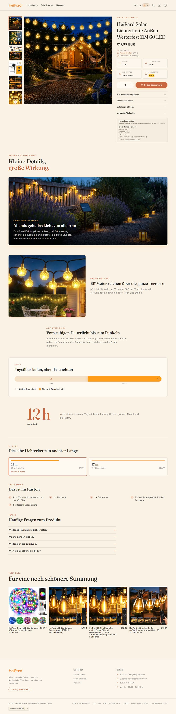
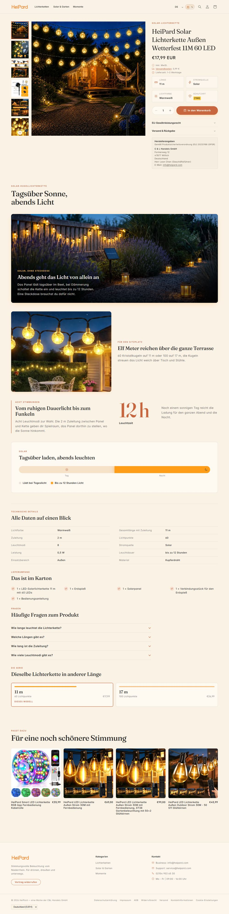
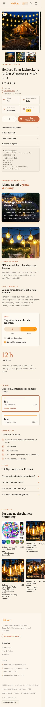
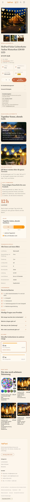

# Feature-Sets Welle 2: Bericht (Durchlauf 1 und 2, Wirkungs-Runde)

Stand 2026-10-21, abends. Auftrag: `heipard-theme-auftrag-feature-sets-welle2.md` (von Leon). Quellen im
Asset-Ordner: `reports/metafelder/welle2_metafelder.csv`, `reports/metafelder/fragen_<FAMILIE>.md`,
`reports/auftrag_13.md` (Dateien und Hotspot-JSONs). Shop vor jedem Schreiben geprüft: `get-shop-info` =
HeiPard, heipard.myshopify.com. Theme-Code unverändert; geändert sind nur die Startseiten-Vorlage
(Bild der Markenstory) und Dokumentation.

## Vorlauf: familie, dramaturgie, Familien-Kollektionen

- `heipard.familie` an 15 Produkten und `heipard.dramaturgie` an allen 20 gesetzt, nach dem Blatt (Status
  „Vorgabe Leon"). Die fünf bestehenden `familie`-Werte (hp-npt-210, hp-ctl-180m, hp-ctl-240m, hp-blt-050,
  hp-dgm-001) sind unverändert.
- Zehn Smart Collections angelegt wie `familie-ol-g40`: `familie-dct`, `-vit`, `-olas14`, `-blm`, `-dfm`, `-sblb`,
  dazu `-ctl`, `-blt`, `-npt`, `-dgm`, die ebenfalls fehlten. Titel „Serie <CODE>", Regel Metafeld *Familie (Code)*
  gleich Code, im Onlineshop veröffentlicht, `seo.hidden` = 1.

## 1. Metafelder

Alle 207 Zeilen des Blatts haben einen gültigen Status. 148 standen schon richtig im Shop, 59 sind neu
geschrieben (35 `familie`/`dramaturgie`, 24 Fachwerte). Typen nach der Baukasten-Tabelle, Variantenzeilen an
der Variante. Abweichungen zum Shop gab es keine.

`dimmstufen` an HP-NPT-210M ist eine Variantenzeile. Dafür gibt es seit Durchlauf 2 die Varianten-Definition
`heipard.dimmstufen` (Liste Ganzzahl, „Dimmstufen (%)", Storefront-Zugriff wie die übrigen
Varianten-Definitionen). Der Wert an HP-NPT-210M hängt jetzt an dieser Definition.

## 2. Fragen

38 Einträge *HeiPard Produktfrage* (`<familie>-frage-<n>`, z. B. `dct-frage-1`), am Metafeld `fragen` der
20 Produkte verknüpft (73 Verknüpfungen). Fragen mit eingeschränktem Geltungsbereich hängen nur dort:
`blt-frage-1` (Timer) nur an hp-blt-050, `ctl-frage-4` nur an hp-ctl-180m und -240m, `vit-frage-3` nur an
hp-vit-586l-eu-1, `vit-frage-4` nur an hp-vit-864l-eu-1. Die DGM-Fragen betreffen den Stern und hängen nur an
hp-dgm-001.

„Auto · Fragen" steht nach Leons Entscheidung in allen Sets in der Daten-Zone, auch in Standard und Long-Tail,
und ebenso in den Vorlagen `vorlage-standard` und `vorlage-longtail`. Das Block-Vokabular führt D7 jetzt bei
allen drei Dramaturgien.

## 3. Sets und Blöcke

Kicker stehen in normaler Schreibung, das Theme setzt sie in Großbuchstaben (wie bei OL-G40). Blöcke mit
„Auto · …" sind die geteilten Einträge der Vorlagen.

| Set (Handle) | Produkte | Blöcke in Reihenfolge | Daten-Zone | Bild offen |
|---|---|---|---|---|
| DCT (Hero) `dct` | hp-dct-200 | B1 Pergola im Regen · B2 Wohnzimmerfenster · R1 Modi und Timer · I1 Schieber (an/aus) · Auto Kettenplan · P1 Fernbedienung · Auto Zeitband · Auto Icon-Grid | Serienleiter, Nachweise, Lieferumfang, Fragen | keins |
| NPT (Hero) `npt` | hp-npt-210 | B1 Busch im Vorgarten · B2 Wohnzimmerfenster · R1 Modi und Timer · I1 Schieber (an/aus) · Auto Kettenplan · P1 Fernbedienung · Auto Zeitband · Auto Icon-Grid | wie DCT | keins |
| VIT 864L (Hero) `vit-864l` | hp-vit-864l-eu-1 | B1 Gartenparty · B2 Dachkante im Schnee · R1 Netzteil und IP44 · I1 Schieber 864L (`VIT_I1_01_an`, Aus per CSS) · Auto Kettenplan · P1 Fernbedienung · Auto Zeitband · Auto Icon-Grid | wie DCT | keins |
| VIT 586L (Hero) `vit-586l` | hp-vit-586l-eu-1 | wie 864L, Schieber 586L (`VIT_I1_02_an`, Aus per CSS) | wie DCT | keins |
| OLAS14 (Hero) `olas14` | hp-ola-s14-15-eu, -30-eu, -50-eu | B1 Terrasse und Pool · B2 Warmes Licht · R1 Fernbedienung und App · Steuerung (Dauer, Atem, Blinken; Basisbild `OLAS14_B2_01`) · Auto Kettenplan · P1 Fernbedienung (1:1) · Auto Zeitband · Auto Icon-Grid | wie DCT | keins |
| CTL (Standard) `ctl` | hp-ctl-180m, -240m, -210-eu-1, -400-eu-1 | B1 Tanne im Wohnzimmer (`KAT-CTL_B1_01`) · B2 Weihnachtsbaum · R1 Modi und Helligkeit · Auto Kettenplan sonst Zeitband · Auto Icon-Grid | Serienleiter, Nachweise, Lieferumfang, Fragen | keins |
| BLT (Standard) `blt` | hp-blt-050, hp-blt-100-eu-1 | B1 Gartentisch (`KAT-LED_B1_01`) · B2 Gartenparty · R1 Modi und IP44 · Auto Kettenplan sonst Zeitband · Auto Icon-Grid | wie CTL | keins |
| BLM (Standard) `blm` | hp-blm-100-eu | B1 Gartentisch (`KAT-LED_B1_01`) · B2 Kinder · R1 Timer und IP44 · Auto Kettenplan sonst Zeitband · Auto Icon-Grid | wie CTL | keins |
| DFM (Standard) `dfm` | hp-dfm-400-eu-2, hp-dfm-600, hp-dfm-750-eu | B1 Gartenbaum (`KAT-CLUSTER_B1_01`) · B2 Lichtfarben · R1 Modi und Helligkeit · Auto Kettenplan sonst Zeitband · D6 Kennzahl LED-Anzahl | wie CTL | `DFM_B2_01` (kommt aus Hermes) |
| SBLB (Standard) `sblb` | hp-sblb-60l-ww-new, hp-sblb-100l-ww-new | B1 Gartenzaun (`KAT-SOLAR_B1_01`) · B2 Terrasse · R1 Modi und Zuleitung · Auto Zeitband (Solar) · D6 Kennzahl Leuchtdauer | wie CTL | keins |
| DGM (Long-Tail) `dgm` | hp-dgm-001 | B1 Vorgarten im Schnee (`KAT-MOTIF_B1_01`) · R1 Außenbereich · Auto Kennzahl | Serienleiter, Nachweise, Fragen | keins |

Bezeichnungen (intern) nach Schema „DCT · B1 Pergola im Regen". Die Blöcke B1, B2, R1 und P1 teilen sich die
beiden VIT-Sets. Das Steuerungs-Basisbild von OLAS14 ist dasselbe wie das B2-Bild (Vorgabe).

**Entscheidungen im Aufbau:**
- DFM und SBLB haben fünf Plätze. D6 (LED-Anzahl bzw. Leuchtdauer) steht auf dem letzten Platz, das Icon-Grid
  entfällt dort. Bei SBLB nimmt das Solar-Zeitband den Platz von D1/D3 ein.
- OLAS14 „Linie mit Koppelplan": Der Koppelplan braucht die beleuchtete Länge, die fehlt im Blatt. Der
  Kettenplan zeigt deshalb die reduzierte Linie mit Gesamtlänge und 3 m Zuleitung.
- Texte nur aus Blatt, Faktenliste und Fragen. Wo Fakten fehlen, beschreibt der Text die Szene des Bildes.
  Die App bei OLAS14 ist im Listing-Text und in zwei Bildern belegt und nur erwähnt.
- Die B1-Texte von CTL, DFM, SBLB und DGM sind in Durchlauf 2 an die Szenen der Kategoriebilder angepasst
  (Tanne neben dem Sessel, umwickelter Gartenbaum, Holzzaun über Lavendel, Sterne im verschneiten Vorgarten),
  bei BLT und BLM an den Gartentisch in der Abenddämmerung.

## 4. Zweiter Durchlauf (2026-10-21)

- **Schieber:** DCT und NPT mit An- und Aus-Bild. VIT 864L und 586L nur mit An-Bild, das Theme leitet die
  Aus-Seite per CSS ab (abgedunkelt). `DCT_I1_01_aus` ist die Fassung aus Auftrag 12 mit Vermerk
  „Deko-Kette Feigenbaum mit aus".
- **Hotspots:** Bilder `DCT_P1_04`, `NPT_P1_06`, `VIT_P1_01`, `OLAS14_P1_01` (jetzt 1:1). Die Punkte stehen wie in
  Abschnitt 3 von Auftrag 13; sie waren mit dem Stand aus Durchlauf 1 identisch und sind neu gesetzt.
- **Kategoriebilder:** `KAT-CTL_B1_01`, `KAT-CLUSTER_B1_01`, `KAT-SOLAR_B1_01`, `KAT-MOTIF_B1_01` als B1;
  `SBLB_B2_01` als B2.
- **KAT-LED:** `KAT-LED_B1_01` lag ab 17:03 Uhr in Files und ist als B1 bei BLT und BLM eingetragen.
  `KAT-CURTAIN_B1_01` und `_B2_01` liegen ebenfalls in Files, sind aber keinem Welle-2-Block zugeordnet.
- **Offen:** `DFM_B2_01` kommt aus Hermes, der Block ist vorbereitet, das Bild leer.
- **Startseite:** `HOME-11_Markenstory_01.webp` als Bild der Markenstory (`templates/index.json`, Commit
  `365c4e5`, gepusht 17:03 Uhr). Live seit 17:12 Uhr (Prüfsumme gleich main); die Theme-Abfrage hatte den
  neuen Stand zunächst verzögert gemeldet.

## Live-Stand nach Durchlauf 2

Geprüft auf allen 20 Produktseiten (erste Variante) mit Storefront-Passwort, ohne JS-Fehler. Hotspot-Labels
ab Tablet nur bei Hover oder Fokus (geprüft an den berechneten Stilen).

| Produkt | Sichtbar (Hauptbereich) | Daten-Zone |
|---|---|---|
| hp-dct-200 | B1, B2, R1, Schieber, Kettenplan (Fläche), Hotspot, Zeitband, Icon-Grid | Serienleiter, Nachweise, Fragen |
| hp-npt-210 | B1, B2, R1, Schieber, Kettenplan (Fläche), Hotspot, Zeitband, Icon-Grid | Nachweise, Fragen |
| hp-vit-864l-eu-1, hp-vit-586l-eu-1 | B1, B2, R1, Schieber, Hotspot, Icon-Grid | Serienleiter, Nachweise, Fragen |
| hp-ola-s14-15/-30/-50-eu | B1, B2, R1, Steuerung, Kettenplan (Linie), Hotspot, Icon-Grid | Serienleiter, Nachweise, Fragen |
| hp-ctl-180m, -240m | B1, B2, R1, Icon-Grid | Serienleiter, Nachweise, Fragen |
| hp-ctl-210-eu-1, -400-eu-1 | B1, B2, R1, Icon-Grid | Serienleiter, Fragen |
| hp-blt-050, hp-blt-100-eu-1, hp-blm-100-eu | B1, B2, R1, Kettenplan, Icon-Grid | Serienleiter, Nachweise, Fragen |
| hp-dfm-400-eu-2 | B1, B2*, R1, Kettenplan | Serienleiter, Nachweise, Fragen |
| hp-dfm-600 | B1, B2*, R1, Kennzahl | Serienleiter, Nachweise, Fragen |
| hp-dfm-750-eu | B1, B2*, R1, Kettenplan, Kennzahl | Serienleiter, Nachweise, Fragen |
| hp-sblb-60l-ww-new, -100l-ww-new | B1, B2, R1, Zeitband (Solar), Kennzahl | Serienleiter, Fragen |
| hp-dgm-001 | B1, R1, Kennzahl | Serienleiter, Nachweise, Fragen |

\* ohne Bild, Text auf dem Ersatzverlauf des Themes.

**Hinweise, die der Theme-Editor zeigt (fehlende Metafelder oder Bilder):**
- DFM: B2 ohne Bild (`DFM_B2_01`).
- VIT: Kettenplan ohne Breite, Höhe oder Länge, Zeitband ohne `timer_dauer_h`.
- OLAS14: Zeitband ohne `timer_dauer_h` (im Blatt mehrdeutig). Die Spec-Kachel „Stromquelle" zeigt dort
  „[TBD]", weil `stromquelle` fehlt (im Blatt mehrdeutig).
- CTL: weder Länge noch Timer, „Kettenplan sonst Zeitband" bleibt leer. Nachweise bei 210/400 leer.
- DFM: Variante HP-DFM-600 (9 m Warmweiß) ohne Gesamtlänge, dort kein Kettenplan. Variante HP-DFM-400 (6 m
  Warmweiß) ohne LED-Anzahl, dort keine Kennzahl.
- SBLB: Nachweise leer (Schutzart im Blatt mehrdeutig).
- NPT: Serienleiter leer (Familie mit einem Produkt, Varianten unterscheiden sich in der Farbe).
- Lieferumfang: bei allen 20 leer, steht in keiner Faktenliste.

**Notiert, nichts geändert (Leons Entscheidung):**
- Serienleiter im Variantenmodus: Jede Variante ist eine Stufe. Bei Farbe und Größe wiederholen sich die
  Größen (hp-dct-200 sechs Karten, DFM ebenso; bei hp-dfm-600 steht die 9-m-Variante ohne Gesamtlänge am
  Ende, Reihenfolge 9, 18, 18, 9 m). Gruppierung nach Größe wäre eine Code-Änderung.
- `familie-dgm` enthält Stern (hp-dgm-001), Spirale (hp-dgm-002) und Geschenkboxen (hp-dgm-048); die
  Serienleiter zeigt sie als eine Serie.

## Produkt-URLs zum Durchsehen

Shop passwortgeschützt, Passwort bei Leon. Startseite: https://heipard.myshopify.com/

- https://heipard.myshopify.com/products/hp-dct-200
- https://heipard.myshopify.com/products/hp-npt-210
- https://heipard.myshopify.com/products/hp-vit-864l-eu-1
- https://heipard.myshopify.com/products/hp-vit-586l-eu-1
- https://heipard.myshopify.com/products/hp-ola-s14-15-eu
- https://heipard.myshopify.com/products/hp-ola-s14-30-eu
- https://heipard.myshopify.com/products/hp-ola-s14-50-eu
- https://heipard.myshopify.com/products/hp-ctl-180m
- https://heipard.myshopify.com/products/hp-ctl-240m
- https://heipard.myshopify.com/products/hp-ctl-210-eu-1
- https://heipard.myshopify.com/products/hp-ctl-400-eu-1
- https://heipard.myshopify.com/products/hp-blt-050
- https://heipard.myshopify.com/products/hp-blt-100-eu-1
- https://heipard.myshopify.com/products/hp-blm-100-eu
- https://heipard.myshopify.com/products/hp-dfm-400-eu-2
- https://heipard.myshopify.com/products/hp-dfm-600
- https://heipard.myshopify.com/products/hp-dfm-750-eu
- https://heipard.myshopify.com/products/hp-sblb-60l-ww-new
- https://heipard.myshopify.com/products/hp-sblb-100l-ww-new
- https://heipard.myshopify.com/products/hp-dgm-001

## Wirkungs-Runde (2026-10-21, abends)

Auftrag von Leon nach Sichtung der Seiten: Lieferumfang schreiben, alle 40 Blocktexte nach neuer Regel,
vier Layout-Änderungen als Test an hp-sblb-60l-ww-new. Shop vor jedem Schreiben geprüft (HeiPard).

### Vorab: Aufklapper und SEO (nur gelesen, Stand vor dem Umbau)

- **Aufklapper:** „Technische Details" und „Installation & Pflege" sind feste Blöcke der Produktvorlage und
  damit bei allen 119 Produkten gleich, auch bei Welle 1. Sie enthalten nur Platzhalter, die Kunden sehen
  würden: „[TBD: Technische Details werden aus den Produktdaten / Metafeldern (heipard) befüllt.]" und
  „[TBD: Installations- und Pflegehinweise ergänzen.]". Live geprüft an hp-ol-30 und hp-isl-264.
- **SEO-Meta-Descriptions:** bei keinem der 119 Produkte gepflegt (83 aus Welle 1, 36 aus Welle 1b). Auch der
  SEO-Titel ist bei den 50 zuerst abgefragten Produkten leer. Shopify nimmt dann Produkttitel und den Anfang
  der Beschreibung.

### 1. Lieferumfang

52 der 53 neuen Blattzeilen sind geschrieben, „1 × LED-Gartenstecker Stern" bei hp-dgm-001 bleibt bis zur
Antwort von Tyler draußen. hp-dgm-001 zeigt deshalb vorerst nur „1 × Bedienungsanleitung".

- Ein Teil je Zeile, Reihenfolge: Produkt, Zubehör, Bedienungsanleitung zuletzt.
- Variantenzeilen: Neue Varianten-Definition `heipard.lieferumfang` (mehrzeilig). Der Variantenwert ersetzt im
  Theme den Produktwert vollständig, deshalb steht an der Variante die ganze Liste: HP-NPT-210W mit
  Bedienungsanleitung, HP-DFM-600M mit 3 × Ersatzbirnen (wie vorgegeben nur dort).

### 2. Neue Blocktexte und Sektionsüberschriften

Regel: Kicker = Thema in zwei bis drei Worten; Headline = was der Fakt für dich bedeutet; Text = zwei Sätze,
erst die Situation, dann der Fakt mit Zahl; keine Dopplung zwischen Headline und Text. Geprüft per Skript
(Wortzahl Kicker, zwei Sätze, Zahl im Text, keine gemeinsamen Wörter in Headline und Text, keine
Gedankenstriche). SBLB übernimmt Leons Texte wörtlich.

- **Hotspots** haben keinen Text, weil das Textfeld dort die Punkt-Beschriftungen liefert.
- **D6 Kennzahl** hat keinen Kicker mehr: unter der Zahl steht genau ein Label (die Feldbezeichnung).
- **VIT:** B2 und R1 teilen sich beide Produkte. Weil die Zahlen je Produkt verschieden sind, stehen sie in
  den Schiebern (864L: 21,6 m, 15 cm Abstand; 586L: 11 Modi, vier Dimmstufen).
- **SBLB-Set umgestellt:** D6 steht jetzt direkt hinter R1 (wie in Leons Vorgabe), danach das Solar-Zeitband.

| Familie | Block | Kicker | Headline | Text |
|---|---|---|---|---|
| DCT | B1 | Draußen nutzbar | Er darf auch draußen hängen | Unter der Pergola leuchtet der Vorhang weiter, auch wenn der Regen von der Seite hereinweht. Nach IP44 ist er gegen Spritzwasser aus allen Richtungen geschützt. |
| DCT | B2 | Zwei Größen | Deckt ein ganzes Fenster ab | Vor dem Wohnzimmerfenster fallen die Lichtstränge bis hinunter zur Fensterbank. Den Vorhang gibt es 3 m breit und 2 m hoch mit 200 LEDs oder 3 m hoch mit 300 LEDs. |
| DCT | R1 | Acht Stimmungen | Für jeden Abend die passende Stimmung | Zum Lesen soll der Vorhang einfach ruhig leuchten, zur Feier darf es mehr Bewegung sein. Dafür hast du 8 Leuchtmodi, die du mit der mitgelieferten Fernbedienung umschaltest. |
| DCT | I1 | Mit und ohne | Erst mit Licht wird das Fenster zum Blickfang | Zieh den Regler und vergleiche dasselbe Wohnzimmer ohne und mit Vorhang. Die Zuleitung ist 3 m lang, die Steckdose darf also ein Stück entfernt sein. |
| DCT | P1 | Die Fernbedienung | Alles vom Sofa aus einstellen | (kein Text; Punkt-Beschriftungen aus den Tasten) |
| NPT | B1 | Busch und Hecke | Kein Wickeln um jeden Zweig | Im Vorgarten legst du das Netz einfach über den Busch und ziehst es zurecht. Auf 3 x 2 m verteilen sich rund 200 Lichtpunkte. |
| NPT | B2 | Drei Lichtfarben | Warm für gemütlich, bunt für die Feier | Hinter dem Sofa am Fenster macht die bunte Fassung aus dem Wohnzimmer einen Partyraum. Das Netz gibt es in Warmweiß, Weiß und Multicolor. |
| NPT | R1 | Helligkeit und Modi | Mal gedämpft zum Film, mal hell für Besuch | Abends vor dem Fernseher reicht oft ein schwaches Glimmen an der Wand. Du dimmst das Netz in vier Stufen und wählst zwischen 8 Leuchtmodi. |
| NPT | I1 | Mit und ohne | Eine leere Wand bekommt Tiefe | Zieh den Regler und vergleiche die Wand über dem Sofa ohne und mit Netz. Ist die Fläche größer als 3 x 2 m, schließt du einfach ein weiteres Netz an. |
| NPT | P1 | Die Fernbedienung | Licht, Modus und Timer mit einer Hand | (kein Text; Punkt-Beschriftungen aus den Tasten) |
| VIT | B1 | Draußen feiern | Gemacht für Abende im Freien | Bei der Gartenparty hängen die Stränge von der Pergola über den Hortensien. Nach IP44 ist die Kette gegen Spritzwasser aus allen Richtungen geschützt. |
| VIT | B2 | Am Haus | Das Dach trägt Eiszapfen aus Licht | An der verschneiten Dachkante hängen die Stränge senkrecht nach unten. Den Strom bekommt die Kette über ein Netzteil, Batterien musst du also nie wechseln. |
| VIT | R1 | Bequem bedienen | Du musst nicht aufs Dach, um etwas zu ändern | Wenn die Kette an der Dachkante hängt, kommst du schlecht an sie heran. Leuchtmodus und Timer stellst du deshalb mit der mitgelieferten Fernbedienung ein. |
| VIT | I1 (864L) | Mit und ohne | So verwandelt sich die Hausfront am Abend | Zieh den Regler und vergleiche das Haus ohne und mit Eisregen. Die 864L ist 21,6 m lang, die Lichtpunkte hängen im Abstand von 15 cm. |
| VIT | I1 (586L) | Mit und ohne | So verwandelt sich die Hausfront am Abend | Zieh den Regler und vergleiche das Haus ohne und mit Eisregen. Die warmweiße 586L hat 11 Leuchtmodi und lässt sich in vier Stufen dimmen. |
| VIT | P1 | Die Fernbedienung | Ein Druck für jeden Modus | (kein Text; Punkt-Beschriftungen aus den Tasten) |
| OLAS14 | B1 | Für die Terrasse | Lang genug, um den ganzen Garten zu überspannen | Zwischen zwei Häusern gespannt, hängen die Birnen über Terrasse, Rasen und Pool. Die Kette gibt es mit 10, 20 oder 30 m Gesamtlänge. |
| OLAS14 | B2 | Warmes Licht | Gemütlich statt grell | Auf der Terrasse soll das Licht einladen und nicht blenden. Die Birnen leuchten mit 2700 Kelvin, so warm wie eine klassische Glühbirne. |
| OLAS14 | R1 | Aus der Ferne | Du schaltest vom Liegestuhl aus | Wer draußen sitzt, will nicht für jede Änderung zur Steckdose laufen. Die Fernbedienung reicht bis 25 m, alternativ steuerst du die Kette per App. |
| OLAS14 | Steuerung | Probier es aus | Das Licht passt sich dem Abend an | Beim Essen darf es hell sein, später reicht ein sanftes Glimmen. Du dimmst in vier Stufen von 25 bis 100 Prozent und wählst zwischen drei Leuchtmodi. |
| OLAS14 | P1 | Die Fernbedienung | Die wichtigsten Tasten erklärt | (kein Text; Punkt-Beschriftungen aus den Tasten) |
| CTL | B1 | Für den Weihnachtsbaum | Der Baum leuchtet von oben bis unten | Im dunklen Wohnzimmer neben dem Sessel ist die Tanne abends der Blickfang. Je nach Modell sitzen 180 bis 400 LEDs auf den Strängen. |
| CTL | B2 | Zwei Lichtfarben | Klassisch warm oder fröhlich bunt | Unter dem Baum liegen die Geschenke, darüber leuchtet die Kette warmweiß. Je nach Modell wählst du zwischen zwei Lichtfarben, Warmweiß und Multicolor. |
| CTL | R1 | Helligkeit und Modi | Am Heiligabend hell, an ruhigen Abenden gedämpft | Nicht jeder Abend braucht volles Licht am Baum. Du dimmst in vier Stufen und wählst zwischen 8 Leuchtmodi. |
| BLT | B1 | Ohne Steckdose | Licht genau dort, wo kein Kabel hinreicht | Über dem Gartentisch ist selten eine Steckdose in Reichweite. Die Kette läuft mit Batterien bei 4,5 V und hängt deshalb, wo es dir gefällt. |
| BLT | B2 | Vier Längen | Die passende Länge für jeden Platz | Für den Tisch reichen 5 m, für die Pergola über der Gartenparty eher 20 m. Die Kette gibt es in 5, 10, 15 und 20 m mit 50 bis 200 LEDs. |
| BLT | R1 | Eingebauter Timer | Du kannst sie einfach vergessen | Wenn der Abend länger dauert, denkt niemand ans Ausschalten. Bei der 5-m-Kette regelt das der Timer: 6 Stunden an, dann 18 Stunden aus. |
| BLM | B1 | Ohne Steckdose | Frei aufhängen, ganz ohne Kabelsuche | Über dem Gartentisch ist die nächste Steckdose meist zu weit weg. Die Kette läuft mit Batterien und ist nach IP44 auch draußen gegen Spritzwasser geschützt. |
| BLM | B2 | Zwei Längen | Für drinnen und draußen in passender Länge | Die Kinder legen die Kette auf dem Teppich aus, bevor sie ihren Platz findet. Es gibt sie mit 100 LEDs auf 10 m oder mit 150 LEDs auf 15 m. |
| BLM | R1 | Eingebauter Timer | Am nächsten Abend leuchtet sie von selbst wieder | Einmal eingeschaltet, folgt die Kette ihrem eigenen Rhythmus. Der Timer hält sie 6 Stunden an und schaltet sie dann für 18 Stunden ab. |
| DFM | B1 | Dicht gesetzt | Ein Baum, der von innen leuchtet | Um Stamm und Äste gewickelt, zeichnet die Kette jede Form des Gartenbaums nach. Je nach Länge sitzen 400 bis 1500 LEDs dicht an dicht. |
| DFM | B2 | Drei Lichtfarben | Warm, klar oder bunt, je nach Anlass | Zu Weihnachten passt warmes Licht, zur Party darf es bunt sein. Die Kette gibt es in Warmweiß, Kaltweiß und Multicolor, nach IP44 auch für draußen. |
| DFM | R1 | Helligkeit und Modi | Von festlich hell bis ganz sanft | Viele LEDs auf engem Raum können schnell zu hell wirken. Du dimmst in vier Stufen von 25 bis 100 Prozent und wählst zwischen 8 Leuchtmodi. |
| DFM | D6 | (Feldbezeichnung) | - | So viele Lichtpunkte trägt die Länge, die du gewählt hast. Die längste Kette der Serie kommt auf 1500 LEDs bei 22,5 m. |
| SBLB | B1 (Vorgabe Leon) | Solar, ohne Steckdose | Abends geht das Licht von allein an | Das Panel lädt tagsüber im Beet, bei Dämmerung schaltet die Kette ein und leuchtet bis zu 12 Stunden. Eine Steckdose brauchst du dafür nicht. |
| SBLB | B2 (Vorgabe Leon) | Für den Sitzplatz | Elf Meter reichen über die ganze Terrasse | 60 Kristallkugeln auf 11 m oder 100 auf 17 m, die Kugeln streuen das Licht weich über Tisch und Stühle. |
| SBLB | R1 (Vorgabe Leon) | Acht Stimmungen | Vom ruhigen Dauerlicht bis zum Funkeln | Acht Leuchtmodi zur Wahl. Die 2 m Zuleitung zwischen Panel und Kette geben dir Spielraum, das Panel dorthin zu stellen, wo die Sonne hinkommt. |
| SBLB | D6 (Vorgabe Leon) | (Feldbezeichnung) | - | Nach einem sonnigen Tag reicht die Ladung für den ganzen Abend und die Nacht. |
| DGM | B1 | Für den Vorgarten | Der Weg zur Haustür ist auch im Dunkeln zu sehen | Im verschneiten Vorgarten säumen die Sterne den Weg bis zum Eingang. Der Gartenstecker hat 120 LEDs und steckt direkt in der Erde. |
| DGM | R1 | Für draußen | Gemacht für Beet und Weg | Draußen bekommt der Stern Regen und Gießwasser ab. Nach IP44 ist er gegen Spritzwasser aus allen Richtungen geschützt. |

| Set | Sektions-Kicker | Sektionsüberschrift |
|---|---|---|
| `dct` | Lichtervorhang | Licht, das wie ein Vorhang fällt |
| `npt` | Lichternetz | Licht für Busch, Hecke und Wand |
| `vit-864l` | Eisregen-Lichterkette | Lichterregen für Dach und Pergola |
| `vit-586l` | Eisregen-Lichterkette | Lichterregen für Dach und Pergola |
| `olas14` | Außenlichterkette S14 | Warmes Licht über Terrasse und Garten |
| `ctl` | Baum-Lichterkette | Dein Weihnachtsbaum in vollem Licht |
| `blt` | Batterie-Lichterkette | Licht, das keine Steckdose braucht |
| `blm` | Batterie-Lichterkette | Drinnen und draußen ohne Kabel zur Steckdose |
| `dfm` | Cluster-Lichterkette | Dicht gesetztes Licht für Baum und Raum |
| `sblb` | Solar-Kugellichterkette | Tagsüber Sonne, abends Licht |
| `dgm` | Gartenstecker Stern | Sterne für Beet und Weg |

Die Sektionsüberschriften stehen in zwei neuen Feldern am Feature-Set (*Sektionsüberschrift: Kicker*,
*Sektionsüberschrift*). Das Live-Theme liest sie erst nach dem Ausrollen der Layout-Änderung, bis dahin
steht dort weiter „Kleine Details, große Wirkung".

### 3. Layout-Test (nicht live)

Code auf Branch `pdp-layout-welle2` (Commits `2a9ced8`, `79a0f28`), getestet auf einer frischen Kopie des
Live-Themes: *zz-layout-test (pdp-layout-welle2)*, ID 197772607821. Vorschau (Storefront-Passwort nötig):
https://heipard.myshopify.com/products/hp-sblb-60l-ww-new?preview_theme_id=197772607821

1. **Schmale Blöcke paarweise:** Folgen R1, D6 oder D2 aufeinander, stehen sie ab 990 px nebeneinander. R1
   steht linksbündig mit einer dünnen Terracotta-Linie links, allein auf sechs von zwölf Spalten.
2. **Sektionskopf aus dem Set:** Kicker und Überschrift aus den neuen Set-Feldern, die globale Zeile nur als
   Rückfall (z. B. OL-G40, das noch keine eigene Überschrift hat). D6 zeigt nur ein Label: den Kicker, falls
   gepflegt, sonst die Feldbezeichnung.
3. **Abstände:** zwischen den Blöcken und in der Daten-Zone um ein Drittel kleiner. Auf dem Handy geprüft.
4. **Aufklapper in die Daten-Zone:** Reihenfolge Technische Details, Lieferumfang, Nachweise, Installation &
   Pflege, Fragen, Serienleiter. „Versand & Rückgabe" und „EU-Gewährleistungsrecht" bleiben an der Kaufbox.
   - *Technische Details* ist eine Tabelle aus allen gepflegten heipard-Metafeldern, je Feld zuerst an der
     gewählten Variante (wechselt mit der Variante). Keine Freitexte. Ohne Daten erscheint sie nicht.
   - *Installation & Pflege:* neues Metaobjekt *HeiPard Installation & Pflege* (`heipard_pflege`), elf leere
     Einträge, Handle = kat-Tag (kat-led, kat-curtain, kat-christmas-tree-lights, kat-cluster, kat-net,
     kat-icicle, kat-solar, kat-smart, kat-weihnachtsbaum, kat-motif, Rückfall kat-stringlights). Sobald Leon
     dort Text einträgt, erscheint der Block bei allen Produkten der Kategorie.

| Vorher (live) | Nachher (Testkopie) |
|---|---|
|  |  |
|  |  |

Auf der Testkopie zusätzlich geprüft, alle ohne Liquid-Fehler: hp-dct-200, hp-ol-30, hp-isl-264, hp-dfm-600.

**Zur Kenntnis:**
- Die Technik-Tabelle zeigt alle gepflegten Shop-Werte, also auch solche aus dem Welle-1-Import, die das
  Welle-2-Blatt nicht bestätigt (z. B. SBLB Stromquelle „Solar" und 0,5 W, DCT „4 Stufen").
- Paare entstehen nur, wo zwei schmale Blöcke aufeinander folgen: bei SBLB nach der Umstellung, bei hp-dfm-600
  dort, wo der Kettenplan einer Variante leer bleibt. Für DFM wäre die Reihenfolge R1, D6, Kettenplan dieselbe
  Umstellung wie bei SBLB.
- Das alte Vorschau-Theme `zz-feature-preview` (Stand 1.10.) liefert inzwischen eine Fehlerseite und kann
  gelöscht werden; ich habe es nicht angefasst.
- Ausrollen: Branch nach Leons Freigabe auf main mergen, danach Sync-Prüfung per Prüfsumme. Die Testkopie
  kann danach gelöscht werden.

### Commits

- main: `a6bb27c` (HOME-11 live), dieser Bericht.
- Branch `pdp-layout-welle2`: `2a9ced8` (Layout-Code), `79a0f28` (Baukasten-Doku).

### Nachtrag (2026-10-21, spät)

- **Installation & Pflege:** Die elf Texte aus `heipard-pflegetexte.md` stehen in den Metaobjekt-Einträgen, ein
  Absatz je Zeile. Auf der Testkopie an zehn Produkten geprüft: Der spezifische kat-Tag gewinnt, Solar-Ketten
  (kat-solar und kat-stringlights) bekommen den Solar-Text. Der Rückfall kat-stringlights greift derzeit bei
  keinem Produkt, weil alle Lichterketten einen spezifischen kat-Tag tragen.
- **Technik-Tabelle:** ohne `leistung_w`, bis die Werte bestätigt sind (Branch-Commit `dca94fa`, in der Testkopie).
- **`zz-feature-preview`:** nicht gelöscht, der Connector sperrt das Löschen von Themes. Bitte im Admin entfernen.

### Ausgerollt (2026-10-21, 20:07 Uhr)

`pdp-layout-welle2` ist nach Leons Go auf main gemergt (Merge-Commit `3ddf2c6`, getesteter Stand `dca94fa`).
Der GitHub-Sync hat alle acht Dateien um 20:07 Uhr übertragen. Sieben Prüfsummen sind gleich main; die
Produktvorlage hat dieselbe normalisierte Prüfsumme (`e800f09e`) wie in der Testkopie. Live geprüft an den
20 Welle-2-Produkten und fünf weiteren: keine Liquid-Fehler, keine [TBD]-Platzhalter, Daten-Zone in der neuen
Reihenfolge, Sektionsüberschriften aus den Sets. Die Testkopie kann im Admin gelöscht werden.

## Durchlauf 3 und Welle-2-Texte (2026-10-22)

Auftrag von Leon nach dem Bericht zu Auftrag 14, zwei Teile nacheinander. Shop vor jedem Schreiben geprüft
(HeiPard). Die Asset-Instanz hat in dieser Zeit nicht geschrieben.

### A. Durchlauf 3: Feature-Sets

**Dramaturgie hero** neu an zwölf Produkten: SBLB (2), BLT (2), BLM, DFM (3), CTL (4). Damit stehen 19 der 20
Produkte auf hero, hp-dgm-001 bleibt Long-Tail, bis die Hermes-Bilder da sind.

**15 neue Blöcke, ein geänderter:**

- **Laute Blöcke (5):** SBLB Schieber mit `SBLB_I1_01_an` / `_aus`; BLT und BLM Schieber mit `BLT_B2_01` bzw.
  `BLM_B2_01` als An-Bild, die Aus-Seite leitet das Theme per CSS ab; DFM Schieber vorbereitet ohne Bilder (der
  Block bleibt unsichtbar, bis sie da sind); CTL Farbwechsel als Überblendung `CTL_I4_01_ww` / `CTL_I4_01_mc`.
- **Hotspots (5)** mit den Punkt-JSONs aus Auftrag 14: `BLT_P1_03`, `BLM_P1_01`, `CTL_P1_05`, `DFM_P1_01`,
  `SBLB_P1_01`.
- **Zweites B2 als Sticky (5):** DCT mit `DCT_B2_08` (4 Punkte) und NPT mit `NPT_B2_06` (3 Punkte) stehen in
  ihren Sets. CTL (4 Punkte), OLAS14 (4) und VIT (3) sind angelegt, aber noch ohne Bild und deshalb nicht im
  Set, damit kein Platzhalter erscheint. Sobald die Hermes-Bilder da sind: Bild eintragen, Block ins Set.
- **Geändert:** Schieber-Text der 586L nach Leons Festlegung („warmweiß oder bunt, umschaltbar").
- Die Hero-Grenze von acht Blöcken hat bei DCT und NPT Platz gekostet: Das Icon-Grid ist dort für den Sticky-Block
  herausgenommen.

**Set-Übersicht** (fett = neu in Durchlauf 3; danach folgt bei allen die Daten-Zone: Technische Details,
Lieferumfang, Nachweise, Installation & Pflege, Fragen, Serienleiter; bei DGM ohne Lieferumfang)

| Set | Produkte | Dramaturgie | Blöcke |
|---|---|---|---|
| `dct` | hp-dct-200 | hero | B1, B2, R1, Schieber, Kettenplan, **Sticky**, Hotspot, Zeitband |
| `npt` | hp-npt-210 | hero | B1, B2, R1, Schieber, Kettenplan, **Sticky**, Hotspot, Zeitband |
| `vit-864l` | hp-vit-864l-eu-1 | hero | B1, B2, R1, Schieber 864L, Kettenplan, Hotspot, Zeitband, Icon-Grid |
| `vit-586l` | hp-vit-586l-eu-1 | hero | B1, B2, R1, Schieber 586L, Kettenplan, Hotspot, Zeitband, Icon-Grid |
| `olas14` | hp-ola-s14-15/30/50-eu | hero | B1, B2, R1, Steuerung, Kettenplan, Hotspot, Zeitband, Icon-Grid |
| `ctl` | hp-ctl-180m, -240m, -210-eu-1, -400-eu-1 | **hero** | B1, B2, R1, **Farbwechsel**, Kettenplan, **Hotspot**, Zeitband, Icon-Grid |
| `blt` | hp-blt-050, hp-blt-100-eu-1 | **hero** | B1, B2, R1, **Schieber**, Kettenplan, **Hotspot**, Zeitband, Icon-Grid |
| `blm` | hp-blm-100-eu | **hero** | B1, B2, R1, **Schieber**, Kettenplan, **Hotspot**, Zeitband, Icon-Grid |
| `dfm` | hp-dfm-400-eu-2, -600, -750-eu | **hero** | B1, B2, R1, D6, **Schieber** (Bilder folgen), Kettenplan, **Hotspot**, Zeitband, Icon-Grid |
| `sblb` | hp-sblb-60l-ww-new, -100l-ww-new | **hero** | B1, B2, R1, D6, **Schieber**, Kettenplan, **Hotspot**, Zeitband |
| `dgm` | hp-dgm-001 | longtail | B1, R1, D6 |

Kettenplan und Zeitband erscheinen nur, wo die Metafelder der gewählten Variante sie füllen.

**Texte der neuen Blöcke** nach der Textregel vom 21.10. (per Skript geprüft: Kicker zwei bis drei Worte, zwei
Sätze mit Zahl, keine Dopplung zwischen Headline und Text, keine Gedankenstriche). Hotspots haben keinen Text,
weil das Textfeld dort die Punkt-Beschriftungen liefert. Sticky-Punkte stehen als „Titel | Satz".

| Block | Kicker | Headline | Text |
|---|---|---|---|
| SBLB Schieber | Mit und ohne | Abends verwandelt sich die Terrasse | Zieh den Regler und vergleiche den Sitzplatz ohne und mit Licht. Je nach Länge leuchten 60 oder 100 Kristallkugeln über Tisch und Stühlen. |
| BLT Schieber | Mit und ohne | So viel Stimmung bringt eine Kette | Zieh den Regler und sieh dieselbe Gartenparty ohne und mit Licht. Je nach Länge leuchten 50 bis 200 warmweiße LEDs. |
| BLM Schieber | Mit und ohne | Erst das Licht macht den Abend gemütlich | Zieh den Regler und vergleiche dieselbe Szene ohne und mit Lichterkette. Je nach Länge leuchten 100 oder 150 warmweiße LEDs. |
| DFM Schieber | Mit und ohne | Ein Lichtband statt einzelner Punkte | Zieh den Regler und vergleiche dieselbe Szene ohne und mit Cluster-Kette. Je nach Länge sitzen 400 bis 1500 LEDs dicht an dicht. |
| CTL Farbwechsel | Zwei Lichtfarben | Probier aus, was zu deinem Baum passt | Tipp auf die Buttons und sieh denselben Weihnachtsbaum in Warmweiß und in Multicolor. Die Modelle mit 210 und 400 LEDs gibt es in beiden Lichtfarben, die mit 180 und 240 LEDs in Multicolor. |
| VIT Schieber 586L (geändert) | Mit und ohne | So verwandelt sich die Hausfront am Abend | Zieh den Regler und vergleiche das Haus ohne und mit Eisregen. Die 586L leuchtet warmweiß oder bunt, umschaltbar, mit 11 Leuchtmodi und vier Dimmstufen. |
| BLT Hotspot | Die Bedienung | Alles direkt an der Batteriebox | (Punkt-Beschriftungen) |
| BLM Hotspot | Die Bedienung | Alles direkt an der Batteriebox | (Punkt-Beschriftungen) |
| CTL Hotspot | Die Fernbedienung | Bedienen, ohne aufzustehen | (Punkt-Beschriftungen) |
| DFM Hotspot | Die Fernbedienung | Dimmen und umschalten aus der Ferne | (Punkt-Beschriftungen) |
| SBLB Hotspot | Das Solarpanel | Hier entsteht die Energie für den Abend | (Punkt-Beschriftungen) |
| DCT Sticky | Für draußen | Bereit für die Pergola | Spritzwasser: Nach IP44 geschützt, Regen von der Seite macht dem Vorhang nichts aus. · 3 m Zuleitung: Die Steckdose darf ein Stück vom Vorhang entfernt sein. · Timer: Nach 6 oder 8 Stunden geht der Vorhang von selbst aus. · 5 V: Der Vorhang arbeitet mit Kleinspannung. |
| NPT Sticky | Hecke und Busch | Ein Netz statt vieler Meter Kette | 3 x 2 m: So viel Fläche bedeckt ein einzelnes Netz. · Weitere Netze: Für größere Flächen schließt du einfach ein zweites an. · Timer: Nach 6 oder 8 Stunden geht das Netz von selbst aus. |
| CTL Sticky (ohne Bild) | Auf einen Blick | Was die Baumkette mitbringt | Von oben nach unten: Die Stränge fallen von der Spitze gleichmäßig über die Äste. · Je nach Modell: 180, 210, 240 oder 400 LEDs sitzen auf den Strängen. · 8 Leuchtmodi: Für jeden Abend die passende Stimmung. · Netzteil: Den Strom liefert ein Netzteil, Batterien brauchst du keine. |
| OLAS14 Sticky (ohne Bild) | Auf einen Blick | Was die Außenkette mitbringt | Ersatzbirnen: Je nach Länge liegen eine oder zwei bei. · Koppelbar: Bei der 20-m-Kette verbindest du bis zu vier Ketten. · Fernbedienung: Sie reicht bis 25 m, alternativ steuerst du per App. · 24 V: Die Kette arbeitet mit Kleinspannung. |
| VIT Sticky (ohne Bild) | Auf einen Blick | Was die Eisregen-Kette mitbringt | Spritzwasser: Nach IP44 aus allen Richtungen geschützt. · Netzteil: Den Strom liefert ein Netzteil, Batterien brauchst du keine. · Fernbedienung: Modus und Helligkeit stellst du bequem vom Boden aus ein. |

### B. Welle-2-Texte

Grundlage ist der Entwurf `heipard-welle2-texte-entwurf.md` mit Leons Festlegungen vom 22.10.:

- **VIT 586L:** „warmweiß oder bunt, umschaltbar" in Titel, Beschreibung, Meta und Schieber-Text, ohne Länge.
- **Innen und außen** nur bei eindeutigem IP44: neu bei CTL 180M und 240M, NPT ohne.
- **Bleiben draußen:** CTL-400-Länge, OLAS14-50-Birnenzahl, CTL-Timer.
- **BLT 5 m:** „3 x AA-Batterien nicht enthalten" als Hinweis in der Beschreibung und als zweite Zeile im
  Lieferumfang der Variante HP-BLT-050. Die 20-m-Variante zeigt weiter nur die Kette (live geprüft).
- **DGM:** ohne Stückzahl und Stromquelle.

**Geschrieben: 81 Felder.** An allen 20 Produkten Titel, Beschreibung (descriptionHtml), subtitle und
Meta-Description (80 Felder), dazu der Lieferumfang an HP-BLT-050. Keine Fehlermeldungen, aus dem Admin
zurückgelesen. Meta-Descriptions 140 bis 155 Zeichen. Handles unverändert.

**Live geprüft** (17:40 Uhr, alle 20 Seiten, per Skript gegen die Vorlage): Titel, subtitle, jeder Absatz der
Beschreibung und `<meta name="description">` stimmen wörtlich, keine Liquid-Fehler. Der Pflege-Kicker zeigt jetzt „Installation & Pflege" statt „&amp;" (Fix
`be7ff76`, seit 17:36 Uhr im Live-Theme, Prüfsumme gleich main).

### Zur Kenntnis und zur Entscheidung

1. **SEO-Titel wird abgeschnitten.** Ohne eigenen SEO-Titel nimmt Shopify den Produkttitel und kürzt ihn nach
   70 Zeichen, auch mitten im Wort. Das betrifft 14 der 20 Seiten (z. B. `<title>` „HeiPard
   Batterie-Lichterkette 5 m oder 20 m, warmweiß, für innen und a"). Vorschlag für einen SEO-Titel, nicht
   geschrieben:

   | Produkt | Vorschlag SEO-Titel | Zeichen |
   |---|---|---|
   | hp-dct-200 | HeiPard LED-Lichtervorhang 3 x 2 m oder 3 x 3 m, für innen und außen | 68 |
   | hp-vit-586l-eu-1 | HeiPard Eisregen-Lichterkette außen, warmweiß oder bunt, umschaltbar | 68 |
   | hp-ola-s14-50-eu | HeiPard Außenlichterkette S14, 30 m, warmweiß, dimmbar | 54 |
   | hp-ctl-180m | HeiPard Baum-Lichterkette 1,5 m, 180 LEDs, bunt, für innen und außen | 68 |
   | hp-ctl-210-eu-1 | HeiPard Baum-Lichterkette mit Ring, 210 LEDs, warmweiß oder bunt | 64 |
   | hp-ctl-400-eu-1 | HeiPard Baum-Lichterkette mit Ring, 400 LEDs, warmweiß oder bunt | 64 |
   | hp-blt-050 | HeiPard Batterie-Lichterkette 5 m oder 20 m, warmweiß, mit Timer | 64 |
   | hp-blt-100-eu-1 | HeiPard Batterie-Lichterkette 10 m oder 15 m, für innen und außen | 65 |
   | hp-blm-100-eu | HeiPard Batterie-Lichterkette 10 m oder 15 m, warmweiß, mit Timer | 65 |
   | hp-dfm-400-eu-2 | HeiPard Cluster-Lichterkette 6 m oder 15 m, in drei Lichtfarben | 63 |
   | hp-dfm-600 | HeiPard Cluster-Lichterkette 9 m oder 18 m, warmweiß oder bunt | 62 |
   | hp-dfm-750-eu | HeiPard Cluster-Lichterkette 11,25 m oder 22,5 m, warmweiß oder bunt | 68 |
   | hp-sblb-60l-ww-new | HeiPard Solar-Lichterkette mit Kristallkugeln, 11 m, für außen | 62 |
   | hp-sblb-100l-ww-new | HeiPard Solar-Lichterkette mit Kristallkugeln, 17 m, für außen | 62 |

2. **Timer-Punkte in Hotspots:** `BLT_P1_03` zeigt einen Timer-Punkt, das BLT-Set gilt aber auch für
   hp-blt-100-eu-1 ohne Timer. `CTL_P1_05` und `DFM_P1_01` zeigen ebenfalls einen Timer, obwohl kein Timer-Fakt
   bestätigt ist (CTL-Timer bleibt laut Festlegung draußen).
3. **CTL-Fernbedienung:** Der Lieferumfang von CTL 210 und 400 nennt keine Fernbedienung, der CTL-Hotspot zeigt
   eine. Das Set gilt für alle vier CTL.
4. **CTL Farbwechsel** steht auch bei 180M und 240M, die es nur in Multicolor gibt. Der Text sagt das, ein
   eigenes Set für die beiden wäre die Alternative. Außerdem behandeln `ctl-b2` und der Farbwechsel beide die
   Lichtfarben; B2 könnte ein anderes Thema bekommen.
5. **BLT/BLM-Schieber** zeigen bis zu den Aus-Bildern dasselbe Bild wie B2.
6. **Lieferumfang:** Auch die Zeile „3 x AA-Batterien nicht enthalten" bekommt das Häkchen. Vorschlag: Zeilen
   mit „nicht enthalten" im Theme ohne Häkchen zeigen (kleine Code-Änderung, nicht gemacht).
7. **VIT 864L:** Titel und Meta sagen „bunt" (Shop-Wert), das Schieberbild zeigt warmweiß und bunt. Festgelegt
   ist nur die 586L. Die 586L trägt als Farb-Tag nur „Warmweiß", im Farbfilter fehlt sie unter Multicolor.
8. **Tag `todo-text`** steht noch an zehn Produkten, deren Texte jetzt geschrieben sind: hp-dct-200, hp-npt-210,
   hp-ctl-180m, hp-ctl-240m, hp-blt-050, hp-blt-100-eu-1, hp-dfm-400-eu-2, hp-dfm-600, hp-dfm-750-eu,
   hp-dgm-001. Nicht entfernt.
9. **DGM:** Das Long-Tail-Set hat keinen Lieferumfang-Block, die Seite zeigt also gar keinen Lieferumfang (nicht
   nur die Bedienungsanleitung, wie im Bericht vom 21.10. stand).

### Produkt-URLs

Shop passwortgeschützt, Passwort bei Leon.

- https://heipard.myshopify.com/products/hp-dct-200
- https://heipard.myshopify.com/products/hp-npt-210
- https://heipard.myshopify.com/products/hp-vit-864l-eu-1
- https://heipard.myshopify.com/products/hp-vit-586l-eu-1
- https://heipard.myshopify.com/products/hp-ola-s14-15-eu
- https://heipard.myshopify.com/products/hp-ola-s14-30-eu
- https://heipard.myshopify.com/products/hp-ola-s14-50-eu
- https://heipard.myshopify.com/products/hp-ctl-180m
- https://heipard.myshopify.com/products/hp-ctl-240m
- https://heipard.myshopify.com/products/hp-ctl-210-eu-1
- https://heipard.myshopify.com/products/hp-ctl-400-eu-1
- https://heipard.myshopify.com/products/hp-blt-050
- https://heipard.myshopify.com/products/hp-blt-100-eu-1
- https://heipard.myshopify.com/products/hp-blm-100-eu
- https://heipard.myshopify.com/products/hp-dfm-400-eu-2
- https://heipard.myshopify.com/products/hp-dfm-600
- https://heipard.myshopify.com/products/hp-dfm-750-eu
- https://heipard.myshopify.com/products/hp-sblb-60l-ww-new
- https://heipard.myshopify.com/products/hp-sblb-100l-ww-new
- https://heipard.myshopify.com/products/hp-dgm-001

## Abschluss Welle 2 (2026-10-23)

Leons Entscheidungen zu den Punkten 1 bis 6 aus dem Bericht vom 22.10. Shop vor jedem Schreiben geprüft
(HeiPard). Welle 2 ist damit bis auf die Hermes-Bilder abgeschlossen.

| Punkt | Umgesetzt |
|---|---|
| 1. SEO-Titel | An allen 20 Produkten, alle höchstens 70 Zeichen (52 bis 69). 15 eigene Werte; bei 5 Produkten ist der SEO-Titel gleich dem Produkttitel, dort speichert Shopify keinen eigenen Wert. Live steht der `<title>` auf allen 20 Seiten vollständig. |
| 2. Hotspots | Timer-Punkt entfernt bei BLT, CTL und DFM, nach derselben Regel auch bei VIT und OLAS14 (Timer dort „mehrdeutig" bzw. fehlt). Belegt und geblieben: DCT, NPT, BLM. Das Metafeld `fernbedienung` ist bei allen leer, entschieden hat der Lieferumfang: P1 bleibt in CTL (M) (180M/240M nennen die Fernbedienung), raus aus CTL (WW/MC) und aus dem DFM-Set. |
| 3. CTL geteilt | Set `ctl` heißt jetzt „CTL (WW/MC)" (210, 400): B1, B2, R1, Farbwechsel, Kettenplan, Zeitband, Icon-Grid. Neues Set `ctl-m` „CTL (M)" (180M, 240M): B1, B2, R1, Steuerung, Kettenplan, Hotspot, Zeitband, Icon-Grid. Daten-Zone in beiden wie bisher. |
| 4. VIT 864L | Titel, Meta (148 Zeichen) und Beschreibung mit „warmweiß oder bunt, umschaltbar", dazu SEO-Titel. Die `lichtfarbe`-Auswahlliste kennt nur Warmweiß, Kaltweiß, Multicolor und RGB, keine Zweifarb-Option: beide VIT unverändert. |
| 5. `todo-text` | An den zehn Produkten entfernt. |
| 6. Lieferumfang | Theme-Commit `04ea287`, live seit 12:04 Uhr (Prüfsummen gleich main, vorher auf der Testkopie geprüft). Zeilen, die mit „nicht enthalten" oder „ohne" beginnen, stehen ohne Häkchen. Damit die BLT-Zeile in Leons Wortlaut bleibt, gilt das auch für Zeilen, die auf „nicht enthalten" enden. „Auto · Lieferumfang" steht in der Long-Tail-Vorlage und im DGM-Set; hp-dgm-001 zeigt „1 × Bedienungsanleitung". |

**Neue und geänderte CTL-Blöcke** (Textregel per Skript geprüft, nur belegte Fakten):

| Block | Set | Kicker | Headline | Text |
|---|---|---|---|---|
| `ctl-b2` (geändert) | WW/MC | Mit Ring | Gleichmäßig verteilt, ohne langes Wickeln | Beim Schmücken legst du den Ring auf die Baumspitze und lässt die Stränge über die Äste fallen. Je nach Modell hängen daran 210 oder 400 LEDs. |
| `ctl-farbwechsel` (geändert) | WW/MC | Zwei Lichtfarben | Probier aus, was zu deinem Baum passt | Tipp auf die Buttons und sieh denselben Weihnachtsbaum in Warmweiß und in Multicolor. Beide Lichtfarben gibt es für die Kette mit 210 und mit 400 LEDs. |
| `ctl-m-b2` (neu) | M | Innen und außen | Leuchtet am Sessel und vor der Haustür | Steht die Tanne draußen, bekommt sie Regen und Schnee ab. Nach IP44 ist die Kette gegen Spritzwasser geschützt, und dank 3 m Zuleitung darf die Steckdose ein Stück entfernt sein. |
| `ctl-m-r1` (neu) | M | Dicht gesetzt | Das Licht verteilt sich über den ganzen Baum | Abends fällt am Baum jede Lücke sofort auf. Auf den Strängen sitzen die LEDs im Abstand von 10 cm. |
| `ctl-m-steuerung` (neu) | M | Probier es aus | So wirkt dein Baum in jeder Stimmung | Zum Auspacken der Geschenke darf es hell sein, später reicht ein sanftes Glimmen. Du dimmst in vier Stufen von 25 bis 100 Prozent und wählst zwischen 8 Leuchtmodi. |

- **Steuerung CTL (M):** Basisbild `CTL_I4_01_mc`, Dimmstufen 25/50/75/100 aus dem Metafeld. Der Block kann nur
  drei Modi zeigen (Dauerlicht, Atemlicht, Blinken); alle drei gehören zu den acht belegten Modi (Dauerlicht und
  Blinken wörtlich, Atemlicht = SLO-GLO). Die Zahl 8 steht im Text.
- **Eigenes R1 für CTL (M):** Das gemeinsame R1 („Helligkeit und Modi") hätte neben der Steuerung dasselbe
  gesagt, deshalb steht dort der belegte 10-cm-Abstand.
- **VIT-R1:** „Leuchtmodus und Timer" ersetzt durch „Leuchtmodus und Helligkeit", weil der Timer bei VIT nicht
  belegt ist (Fehler im Text vom 21.10.).

**Live geprüft** (alle 20 Seiten, per Skript): Seitentitel = SEO-Titel und höchstens 70 Zeichen, Meta,
Titel und Beschreibung wörtlich, keine Liquid-Fehler, Timer nur noch in den Hotspots von DCT, NPT und BLM,
CTL (M) mit Steuerung (vier Stufen, drei Modi) und Hotspot, CTL (WW/MC) mit Farbwechsel ohne Hotspot, DFM ohne
Hotspot, BLT 5 m mit „3 x AA-Batterien nicht enthalten" ohne Häkchen.

**Offen:**
- Hermes-Bilder: DFM_B2_01, DFM-Schieber, Aus-Bilder BLT/BLM, Sticky-Bilder CTL/OLAS14/VIT, DGM.
- Zur Kenntnis: Die 600 ist die einzige DFM mit Fernbedienung im Lieferumfang. Ein eigenes Set wie bei CTL
  würde ihr den Hotspot zurückgeben.
- Zur Kenntnis: CTL (M) zeigt in B1 und B2 noch warmweiße Bilder, obwohl 180M/240M nur Multicolor sind.
